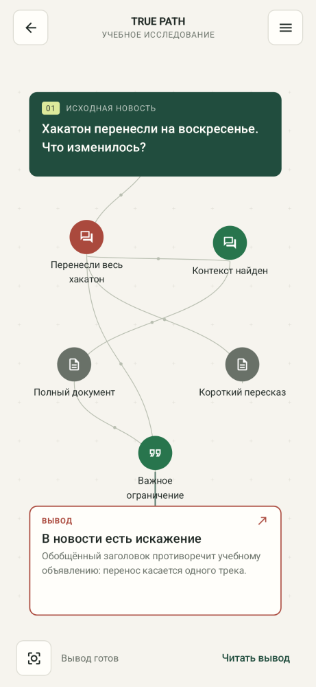
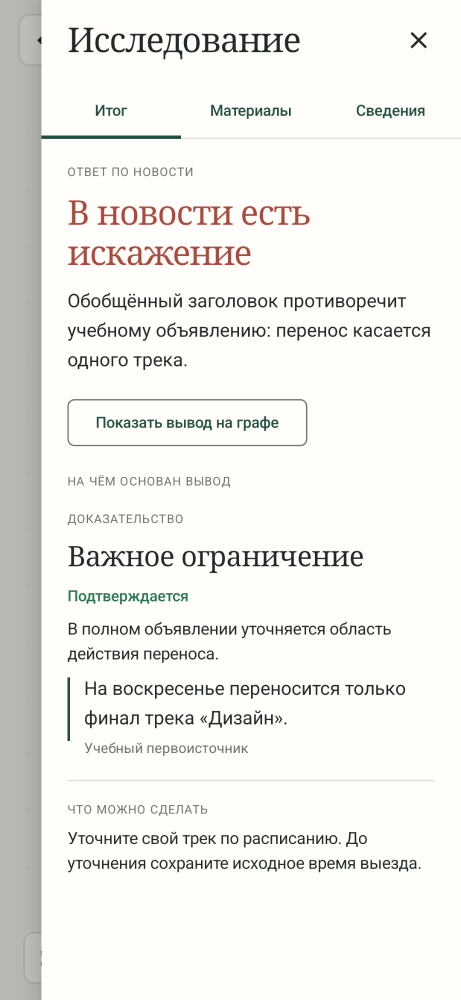

<div align="center">

# True Path

### От новости — к основаниям вывода.

Android-приложение для исследования информации.<br>
Лента, материалы пользователя и граф, который показывает, на чём держится вывод.

[](https://github.com/KneelingCrown/TruePath/actions/workflows/android-checks.yml)


[Концепция](docs/PROJECT.md) · [Техническое задание](docs/TECHNICAL_SPEC.md) · [API-контракт](docs/API_CONTRACT.md) · [Разработка и CI](docs/PIPELINE.md)

</div>

---

Новость может верно цитировать документ и всё же искажать его смысл. True Path помогает разобрать публикацию на отдельные утверждения, сопоставить их с источниками и увидеть конкретное основание каждого вывода.

**Сейчас в репозитории — работающий Android-прототип с учебным исследованием.** Реальный фактчекинг через внешние API ещё не подключён. Публикации, источники и результаты демо вымышлены и обозначены в интерфейсе.

## Интерфейс

Светлая и тёмная темы, заголовки с засечками и зелёный акцент. Лента — для чтения; отдельное полотно — для исследования. Цитаты, материалы и подробный ответ открываются в боковой панели.

<table>
  <tr>
    <td align="center" width="33%"></td>
    <td align="center" width="33%"></td>
    <td align="center" width="33%"></td>
  </tr>
  <tr>
    <td align="center">01 · Выбрать материал</td>
    <td align="center">02 · Проследить основания</td>
    <td align="center">03 · Прочитать вывод</td>
  </tr>
</table>

<sub>Реальные Compose-компоненты, отрисованные Paparazzi на компьютере. Это эталоны интерфейса, а не снимки с устройства. Учебные фото — иллюстрации, не доказательства событий. [Все эталоны](app/src/test/snapshots/images/) · [Происхождение медиа](docs/ASSET_CREDITS.md).</sub>

## Что можно попробовать

| Раздел | Текущие возможности |
| --- | --- |
| **Лента** | Четыре учебные публикации, фильтр тем, чтение с фото, встроенным видео и ссылками. Проверка запускается по кнопке. |
| **Проверить** | Текст, ссылки, вставка из буфера и до пяти вложений через системный диалог. Собственный материал сохраняется непроверенным. |
| **Граф** | Органическая раскладка, плавное расширение и обзор, масштабирование и выбор узлов. Большой пример: 32 узла и 59 связей. Вывод и цитаты — в меню справа со свайпом закрытия. |
| **История** | Локальное сохранение, поиск, удаление и повторное открытие графа без нового исследования. Прерванный учебный поток можно продолжить. |

### Один сценарий целиком

В ленте появляется сообщение: «Хакатон перенесли на воскресенье». Пользователь запускает учебную проверку. Граф постепенно показывает утверждения, полный документ и цитату: перенос касается только одного трека. Итог объясняет, почему общий заголовок вводит в заблуждение. «План Б» предлагает уточнить свой трек перед изменением поездки.

Результат остаётся в истории вместе с основаниями. Повторное открытие возвращает сохранённый граф.

### Как читать результат

| Статус утверждения | Значение |
| --- | --- |
| 🟢 Подтверждается | Найденные основания поддерживают утверждение в указанном контексте. |
| 🟡 Недостаточно данных | Остался существенный вопрос или источники расходятся. |
| 🔴 Есть противоречие | Найденные основания противоречат утверждению. |
| ⚪ Не проверено | Исследование ещё не выполнено или утверждение вне его области. |

Статус сопровождается текстом. Отсутствие подтверждения не означает опровержение. Ошибка или обрыв потока не считаются успешной проверкой.

## Граница текущей версии

**Реализованы** интерфейс, учебный поток, локальная история, светлая/тёмная/системная тема и загрузка HTTPS-иллюстраций через Coil. Видео воспроизводится внутри статьи через Media3, с паузой при уходе из приложения и внешней ссылкой при ошибке. Для учебных обложек есть локальные копии.

**Предстоит подключить** реальные новости, исследовательский API, рекомендации и анализ вложений. Содержимое выбранных файлов сейчас не анализируется и не отправляется сервису проверки. Пояснения связей пока недоступны в интерфейсе графа. Для новости история сохраняет граф и заголовок, но ещё не полный снимок статьи с медиаблоками. История не синхронизируется между устройствами.

Собственного сервера нет. По принятой архитектуре Android-клиент будет обращаться к внешним API напрямую. Общий платный ключ не должен попадать в исходники или распространяемый APK. Поставщик должен поддерживать асинхронные задачи, структурированные промежуточные результаты и восстановление исследования по ID — [требования к интеграции](docs/API_CONTRACT.md).

## Запуск разработки

**Нужно:** Android Studio, JDK 17, Android SDK Platform 36 и Build Tools 35.0.0.

1. Клонируйте репозиторий и откройте его корневую папку в Android Studio.
2. Выберите JDK 17 для Gradle и установите компоненты SDK через SDK Manager.
3. Выполните Gradle Sync. Путь к SDK хранится в локальном `local.properties`, который не включается в Git.

Ключи внешних API для учебного сценария не нужны. Для первой синхронизации требуется доступ к репозиториям зависимостей.

| Компонент | Версия |
| --- | --- |
| Kotlin / Compose compiler | 2.1.21 |
| UI | Jetpack Compose · Material 3 |
| Java | 17 |
| Android | minSdk 26 · compileSdk / targetSdk 36 |
| Android Gradle Plugin / Gradle | 8.13.2 / 8.13 |

### Проверки без APK

Linux / macOS, с настроенными JDK и SDK:

```bash
./gradlew --no-daemon --max-workers=4 :app:compileDebugKotlin :app:testDebugUnitTest :app:lintDebug
python3 scripts/check_test_results.py app/build/test-results/testDebugUnitTest
```

Windows PowerShell:

```powershell
$env:JAVA_HOME = 'C:\Program Files\Android\Android Studio\jbr'
.\gradlew.bat :app:compileDebugKotlin :app:testDebugUnitTest :app:lintDebug
python scripts/check_test_results.py app/build/test-results/testDebugUnitTest
```

Путь `JAVA_HOME` — пример: укажите установленный JDK 17 или совместимый JBR. Python 3 нужен для проверки JUnit-отчётов. GitHub Actions выполняет эти проверки на push и PR, сохраняет отчёты тестов и Lint на 14 дней. [Устройство pipeline](docs/PIPELINE.md).

### Визуальные проверки

Paparazzi запускается отдельно, без эмулятора и APK:

```bash
./gradlew :app:verifyPaparazziDebug -Pscreenshots
```

Он сравнивает 17 состояний Compose с эталонами в репозитории. Обычные unit-тесты и текущий CI эту проверку не включают. После намеренного изменения дизайна эталоны обновляются командой `:app:recordPaparazziDebug -Pscreenshots` и просматриваются перед коммитом.

**Проверка на устройстве остаётся отдельным этапом.** Рендеринг не проверяет жесты, плавность, системный выбор файлов и настоящее воспроизведение видео. Перечисленные команды не создают APK/AAB; задачи `assemble`, `package` и `bundle` запускаются только когда нужен установочный артефакт.

## Внутри проекта

```text
app/src/main/java/ru/truepath/app/
├── TruePathViewModel.kt   Навигация, состояние, выполнение исследования
├── domain/               Модели, редуктор событий, представление графа и медиа
├── data/                 Учебный источник и JSON-хранилище истории
└── ui/                   Compose-экраны, граф, медиакомпоненты и тема

app/src/test/             Модульные тесты и эталонные изображения
app/src/screenshot/       Отдельные визуальные тесты
.github/workflows/        Автоматические проверки
```

В основе исследования — `Flow<ResearchEvent>`. Редуктор применяет события без дублей и откладывает связи до появления обоих узлов. История сохраняет граф и ID обработанных событий. При перезапуске незавершённое исследование отмечается прерванным; итог не придумывается. Камера графа сохраняется во время поступления событий.

## Следующий этап: личная память

Развиваем True Path так, чтобы каждое исследование помогало понять следующее: сохранять основания, находить объяснимые связи с прежними знаниями и добровольно возвращаться к важному спустя время. Отдельный журнал эпизодов источников позволит улучшать маршрут проверки; интерес пользователя не будет подменять достоверность.

**Пока не реализовано.** Первый этап — постоянная локальная память, до трёх предложенных ассоциаций, короткое воспроизведение и проверяемый журнал источников. Автоматическое изменение весов — позже, после оценки качества. Не обещаем, что пользователь никогда ничего не забудет.

[Память и адаптация: требования и приёмка](docs/MEMORY_AND_ADAPTATION.md) · [Задания Front и Back](docs/TEAM_HANDOFF.md).

## Работа команды

| Направление | Область ответственности |
| --- | --- |
| **DevOps / Pipeline** | Среда, CI, контроль изменений и воспроизводимость проверок. |
| **Front** | Android-интерфейс, навигация, состояния экранов и визуализация. |
| **Back** | Внешние API, доменные данные, хранение и восстановление задач внутри Android-приложения. |

Два параллельных рубежа: реальная проверка текста с восстановлением API-задачи и локальный цикл «два исследования → объяснимая связь → вопрос → сохранённая память». Для первого нужен проверенный поставщик; второй можно разрабатывать на учебных данных.

[Концепция](docs/PROJECT.md) — зачем и для кого · [ТЗ](docs/TECHNICAL_SPEC.md) — задачи и приёмка · [Журнал](docs/DEVELOPMENT_LOG.md) — решения и выполненные проверки.
